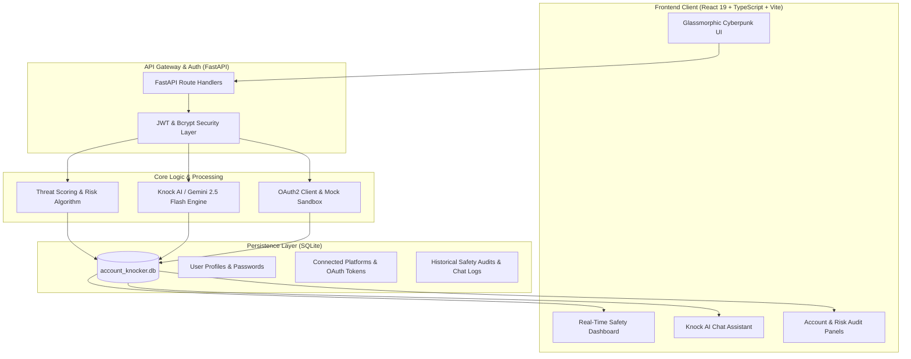

<div align="center">

# 🛡️ Account Knocker
### **Next-Gen AI Digital Safety Assistant & Threat Exposure Scoring Engine**

[](https://fastapi.tiangolo.com)
[](https://www.python.org/)
[](https://react.dev/)
[](https://www.typescriptlang.org/)
[](https://tailwindcss.com/)
[](https://deepmind.google/technologies/gemini/)
[](https://vitejs.dev/)
[](https://opensource.org/licenses/MIT)

<p align="center">
  <b>Account Knocker</b> audits your connected digital identity across Google, GitHub, Discord, and Spotify to detect attack surfaces, calculate real-time threat scores, and provide actionable, AI-driven remediation roadmaps.
</p>

<p align="center">
  <a href="#-key-features">Key Features</a> •
  <a href="#-architecture--data-flow">Architecture</a> •
  <a href="#-scoring-algorithm">Scoring Algorithm</a> •
  <a href="#-quickstart-guide">Quickstart</a> •
  <a href="#-api-reference">API Reference</a> •
  <a href="#-project-structure">Project Structure</a>
</p>

---

</div>

## 📌 Executive Overview

In the modern digital landscape, the average user maintains dozens of OAuth connections, stale application tokens, and unverified session permissions across everyday platforms. These latent access paths represent significant attack surfaces vulnerable to credential stuffing, token hijacking, and privilege abuse.

**Account Knocker** functions as an autonomous **AI Cybersecurity Guardian**:
- 🔍 **Scans & Evaluates**: Audits linked profiles for missing 2FA/MFA, obsolete credentials, stale OAuth tokens, and suspicious geographic logins.
- 🧮 **Quantifies Risk**: Computes an algorithmic 100-point **Digital Safety Score** that reacts instantly to threat exposures and remediations.
- 🤖 **Knock AI Coach**: An interactive security advisor powered by **Google Gemini 2.5 Flash** that analyzes your exact vulnerability posture, suggests prioritized mitigations, and tracks conversational guidance history.
- ⚡ **Interactive Remediation**: Allows users to acknowledge, act upon, and resolve security advisories with instantaneous point recovery.

---

## 🚀 Key Features

### 1. 🛡️ Dynamic Digital Safety Score Card
- Real-time scoring index calculated from **0 to 100**.
- Dynamic status classification:
  - 🟢 **Safe** (85 – 100)
  - 🔵 **Good** (70 – 84)
  - 🟡 **Medium Alert** (50 – 69)
  - 🔴 **Critical Risk** (0 – 49)
- Historical tracking rendered using **Recharts** charts to visualize safety posture improvement over time.

### 2. 🔗 Unified Multi-Platform Auditing
- Connects directly with critical consumer & developer platforms:
  - **Google**: Scans for anomalous geographic logins, unverified devices, and master password freshness.
  - **GitHub**: Audits MFA status, active Personal Access Tokens (PATs), and SSH authentication history.
  - **Discord**: Detects missing multi-factor authentication and dormant third-party bot/app authorizations.
  - **Spotify**: Analyzes credential aging and third-party app scopes.
- **Built-in Mock Sandbox Mode**: Test the full platform instantly without requiring third-party OAuth developer credentials.

### 3. 🤖 Knock AI – Context-Aware Security Copilot
- Powered by **Google Gemini 2.5 Flash** (`google-generativeai`).
- Injects active user security telemetry (connected accounts, open risks, pending remediations) directly into the agent's context window.
- **Zero-Downtime Smart Fallback**: If no Gemini API key is configured, an integrated deterministic expert rule engine takes over seamlessly to answer cybersecurity queries.
- Persistent conversation memory stored in the database.

### 4. ⚡ One-Click Remediation Engine
- Actionable checklists tailored per platform.
- Resolving an advisory immediately triggers recalculation and restores deducted points to the user's score in real time.

### 5. 🎨 Cyberpunk Aesthetic & Modern UI
- Engineered with **React 19**, **Vite 8**, **Tailwind CSS v4**, and **Framer Motion 12**.
- Dark-mode-first glassmorphic styling, neon cyber glows, responsive layout, and smooth page transitions.

---

## 🏗️ Architecture & Data Flow



---

## 🧮 Scoring Algorithm & Vulnerability Matrix

The threat analysis engine initializes every user at a baseline of **100 Points** and evaluates active telemetry against weighted penalty vectors:

| Threat Vector | Severity | Score Impact | Detection Logic |
|---|:---:|:---:|---|
| **Suspicious Login Activity** | Critical | `-25 pts` | Blocked login attempts from foreign proxy/VPN networks |
| **Obsolete Passwords** | High | `-20 pts` | Credentials unchanged for over 360 days (credential stuffing risk) |
| **Missing Multi-Factor Auth (MFA)** | High | `-15 pts` | Inactive 2FA on mission-critical accounts (Google, GitHub, Discord) |
| **Unknown Device Authentication** | High | `-15 pts` | Access tokens or SSH keys used from unverified IP ranges |
| **Stale Third-Party Permissions** | Medium | `-10 pts` | Dormant OAuth permissions unused for >180 days |
| **Clean Connection Hygiene Bonus** | Positive | `+5 pts` | Awarded for active, fully audited, and uncompromised services |

> **Dynamic Restoration**: Remediating any flagged vulnerability instantly recoups the deducted points, updating your badge ranking on the spot.

---

## 🛠️ Technology Stack

| Layer | Technologies |
|---|---|
| **Frontend** | React 19, TypeScript 6, Vite 8, Tailwind CSS v4, Framer Motion 12, Recharts 3, Lucide Icons, Axios |
| **Backend** | Python 3.11+, FastAPI, Uvicorn, SQLAlchemy ORM, Pydantic v2 |
| **Security & Auth** | JWT (`python-jose`), Password Hashing (`passlib`, `bcrypt`), CORS Middleware |
| **AI Integration** | Google Gemini 2.5 Flash (`google-generativeai`), Context-Engineered Prompt System |
| **Database** | SQLite 3 (Thread-safe session management) |
| **Tooling** | Oxlint, PostCSS, Git, PowerShell Automated Launcher |

---

## ⚡ Quickstart Guide

### Prerequisites
- **Node.js** (v20+ recommended)
- **Python** (v3.11 or higher)
- **Git**

---

### Method A: One-Click Launch (Windows)

Simply double-click [`run.bat`](file:///c:/Users/Likethan%20KJ/Documents/project/Account%20Knocker/run.bat) or run it from your terminal:

```cmd
run.bat
```

This will automatically launch:
- 🚀 **FastAPI Backend Server** at `http://localhost:8000`
- 💻 **Vite Frontend Client** at `http://localhost:5173`
- 📑 **Interactive OpenAPI / Swagger Documentation** at `http://localhost:8000/docs`

---

### Method B: Manual Step-by-Step Installation

#### 1. Backend Setup
```bash
# Clone the repository
git clone https://github.com/Likethan/Account-Knocker.git
cd Account-Knocker/backend

# Create and activate virtual environment
python -m venv venv

# Windows (PowerShell):
.\venv\Scripts\Activate.ps1
# Linux / macOS:
source venv/bin/activate

# Install required dependencies
pip install -r requirements.txt

# Create your environment configuration
cp .env.example .env

# Run the FastAPI server
python -m uvicorn app.main:app --port 8000 --reload
```

#### 2. Frontend Setup
```bash
# In a new terminal window, navigate to frontend:
cd Account-Knocker/frontend

# Install dependencies
npm install

# Start the Vite development server
npm run dev
```

Visit **`http://localhost:5173`** to begin your scan!

---

## ⚙️ Environment Variables

Configure your credentials inside `backend/.env` (see [`backend/.env.example`](file:///c:/Users/Likethan%20KJ/Documents/project/Account%20Knocker/backend/.env.example)):

```ini
# Database & Core Security
DATABASE_URL=sqlite:///./account_knocker.db
JWT_SECRET=super-secure-random-jwt-key-change-this-for-production
JWT_EXPIRATION_MINUTES=1440

# AI Configuration (Optional: runs intelligent local fallback if empty)
GEMINI_API_KEY=your-gemini-api-key-here

# Live OAuth Credentials (Optional: simulated demo mode enabled by default)
GOOGLE_CLIENT_ID=
GOOGLE_CLIENT_SECRET=
SPOTIFY_CLIENT_ID=
SPOTIFY_CLIENT_SECRET=
DISCORD_CLIENT_ID=
DISCORD_CLIENT_SECRET=
GITHUB_CLIENT_ID=
GITHUB_CLIENT_SECRET=
```

---

## 📡 REST API Reference

Interactive Swagger documentation is available at **`/docs`** and ReDoc at **`/redoc`**.

### 🔐 Authentication (`/api`)
| Method | Endpoint | Description | Auth Required |
|---|---|---|:---:|
| `POST` | `/api/register` | Register new user profile; issues JWT token | ❌ |
| `POST` | `/api/login` | Authenticate with email/password; returns JWT | ❌ |
| `GET` | `/api/me` | Fetch active authenticated user metadata | ✅ Bearer |

### 🔗 Connected Accounts (`/api/accounts`)
| Method | Endpoint | Description | Auth Required |
|---|---|---|:---:|
| `GET` | `/api/accounts` | List all connected accounts and their health status | ✅ Bearer |
| `POST` | `/api/accounts/mock-connect` | Connect a mock platform with simulated risk profiles | ✅ Bearer |
| `DELETE` | `/api/connect/{platform}` | Sever connection to a linked platform | ✅ Bearer |

### 🛡️ Threat & Risk Analysis (`/api`)
| Method | Endpoint | Description | Auth Required |
|---|---|---|:---:|
| `POST` | `/api/analyze` | Execute complete risk evaluation and generate audit report | ✅ Bearer |
| `GET` | `/api/reports` | Retrieve user audit history and security logs | ✅ Bearer |
| `GET` | `/api/score/history` | Fetch chronological score progression for charts | ✅ Bearer |

### 💬 Knock AI Coach (`/api/chat`)
| Method | Endpoint | Description | Auth Required |
|---|---|---|:---:|
| `POST` | `/api/chat` | Send prompt to AI coach; returns remediation recommendations | ✅ Bearer |
| `GET` | `/api/chat/history` | Retrieve full conversational dialog history | ✅ Bearer |

---

## 📂 Project Structure

```
Account-Knocker/
├── backend/
│   ├── app/
│   │   ├── ai/
│   │   │   └── agent.py              # Gemini 2.5 Flash agent & smart rule fallback
│   │   ├── routers/
│   │   │   ├── accounts.py           # Connected accounts & mock simulation endpoints
│   │   │   ├── auth.py               # Registration, login, profile token verification
│   │   │   ├── chat.py               # AI chat interactions and conversation memory
│   │   │   ├── oauth.py              # OAuth callback routing for external services
│   │   │   └── security.py           # Risk assessment, score history, reporting
│   │   ├── services/
│   │   │   ├── scheduler.py          # Periodic background security audit runner
│   │   │   └── security_engine.py    # Risk assessment logic and mathematical scoring
│   │   ├── auth_service.py           # JWT encoding/decoding & bcrypt hashing helpers
│   │   ├── config.py                 # Pydantic environment settings validator
│   │   ├── database.py               # SQLAlchemy SQLite engine & session factory
│   │   ├── main.py                   # FastAPI application initialization & middleware
│   │   ├── models.py                 # SQLAlchemy relational database tables
│   │   └── schemas.py                # Pydantic request/response schemas
│   ├── .env.example                  # Environment variable reference template
│   └── requirements.txt              # Pinned Python package dependencies
├── frontend/
│   ├── public/                       # Static SVGs, icons, and favicon assets
│   ├── src/
│   │   ├── assets/                   # Brand assets and graphics
│   │   ├── components/               # Modular UI components (Navbar, Sidebar, RiskBadge...)
│   │   ├── context/                  # Authentication state management (AuthContext)
│   │   ├── pages/                    # Views (Landing, Dashboard, Accounts, Reports, AI Chat)
│   │   ├── services/                 # Axios API wrappers with interceptors
│   │   ├── App.tsx                   # Top-level application routing
│   │   ├── index.css                 # Cyber-themed CSS styles, glow effects, scrollbars
│   │   └── main.tsx                  # React DOM root entrypoint
│   ├── package.json                  # NPM dependencies and scripts
│   ├── tailwind.config.js            # Tailwind styling tokens & animations
│   ├── tsconfig.json                 # TypeScript compiler configuration
│   └── vite.config.ts                # Vite bundler configuration
├── .gitignore                        # Git ignore rules for node, python, databases, envs
├── README.md                         # Comprehensive project documentation
└── run.bat                           # Dual-server automated launcher for Windows
```

---

## 🗺️ Roadmap & Upcoming Capabilities

- [ ] **Passkey & WebAuthn Health Auditing**: Native detection of FIDO2 biometric authentication adoption.
- [ ] **HaveIBeenPwned API Integration**: Real-time email leak detection against known global breaches.
- [ ] **Enterprise SaaS Connectors**: Slack workspace permissions, Google Workspace Admin, and AWS IAM role audits.
- [ ] **Automated Remediation Webhooks**: One-click revocation of third-party OAuth access directly via platform APIs.

---

## 📄 License

Distributed under the **MIT License**. See `LICENSE` for more information.

---

<div align="center">
  <sub>Built with ❤️ by <a href="https://github.com/Likethan">Likethan K J</a> • Dedicated to Personal Cybersecurity & Digital Autonomy</sub>
</div>
